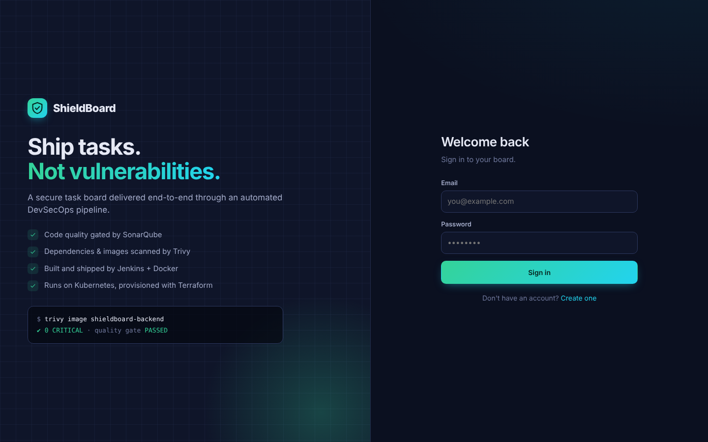
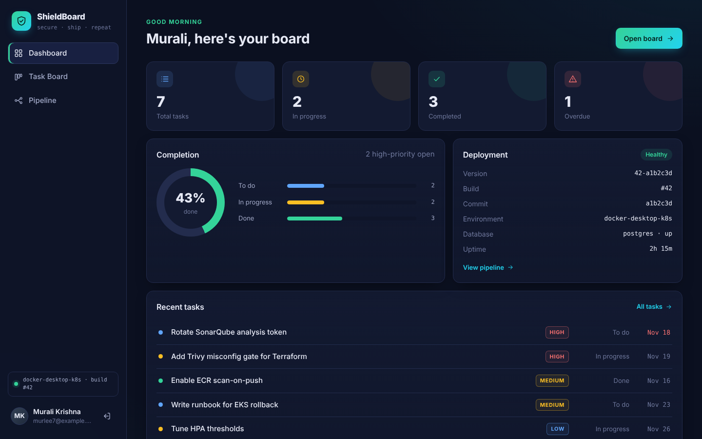
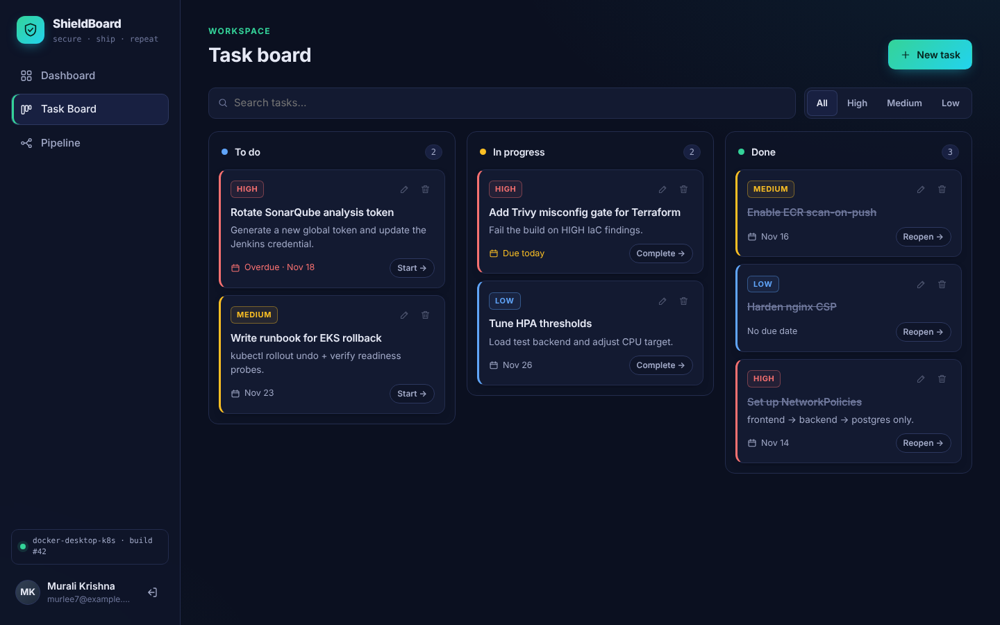
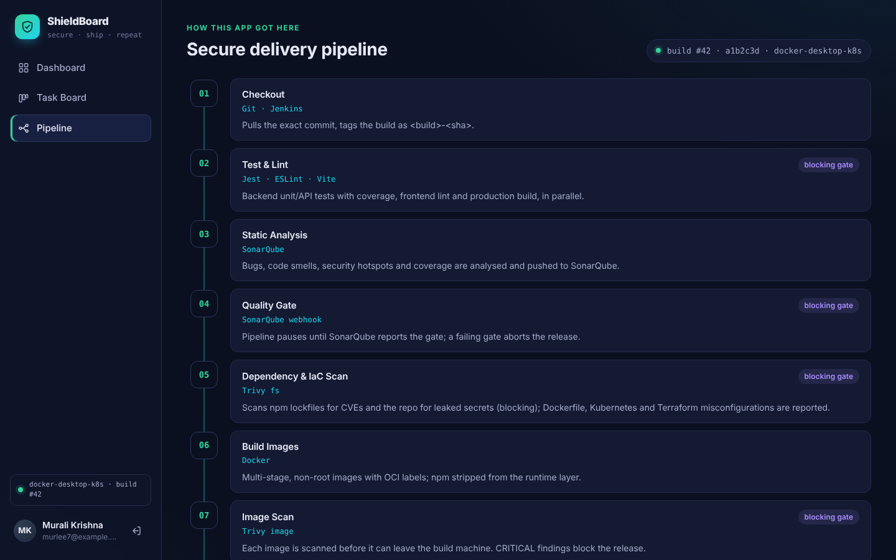
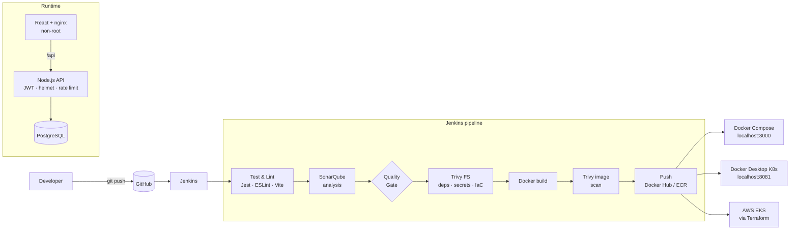

# 🛡️ ShieldBoard — Secure DevSecOps CI/CD Pipeline

**AWS · Jenkins · Docker · Kubernetes · Terraform · SonarQube · Trivy**

ShieldBoard is a full-stack task board (React + Node.js + PostgreSQL) that is built, tested, scanned and deployed
by an automated DevSecOps pipeline. Every change goes through unit tests, SonarQube static analysis with a
quality gate, and Trivy dependency/secret/IaC/image scanning before it can be deployed to Docker Compose,
Docker Desktop Kubernetes, or AWS EKS (provisioned with Terraform).

| Login | Dashboard |
|---|---|
|  |  |
| **Task board** | **Pipeline view** |
|  |  |

---

## Architecture



### What's in the box

| Area | Highlights |
|---|---|
| **Frontend** (`frontend/`) | React 18 + Vite, login/register, dashboard with stats & deployment info, drag-and-drop Kanban board, pipeline page. Served by unprivileged nginx with strict CSP and security headers; `/api` reverse-proxied to the backend. |
| **Backend** (`backend/`) | Express REST API, JWT auth (bcrypt, timing-safe login), per-user task isolation, input validation, rate-limited auth, helmet, `/health` `/ready` `/metrics` (Prometheus) endpoints, graceful shutdown. 30+ Jest/Supertest tests with coverage → SonarQube. |
| **Docker** | Multi-stage builds, non-root users, npm removed from runtime image, healthchecks, OCI labels, read-only containers with dropped capabilities in Compose. |
| **Jenkins** (`jenkins/`, `Jenkinsfile`) | Custom image with Docker CLI, Trivy, sonar-scanner, kubectl, Terraform, AWS CLI, Node. **Configured as code** (JCasC): admin user, SonarQube server, credentials and the pipeline job are created automatically. |
| **SonarQube** | `sonar-project.properties`, LCOV coverage, quality gate enforced via webhook. |
| **Trivy** | Filesystem scan (vulns, secrets, misconfig in Dockerfiles/K8s/Terraform) + image scan; configurable blocking severity; JSON/table reports archived per build. |
| **Kubernetes** (`k8s/`) | Kustomize base + `local` / `aws` overlays. Non-root, read-only root FS, `drop: ALL`, seccomp, probes, resource limits, HPA, PDBs, NetworkPolicies, Pod Security labels. |
| **Terraform** (`terraform/`) | VPC (2 AZs, NAT), EKS (managed node group, IMDSv2, KMS-encrypted secrets, EBS CSI + metrics-server add-ons, access entries), ECR (immutable tags, scan-on-push, KMS, lifecycle policy). |

---

## 1. Quick start — just run the app (5 minutes)

Requirements: **Docker Desktop** (4 GB RAM is enough for this step).

```powershell
# Windows PowerShell (use `cp` on macOS/Linux)
git clone https://github.com/murlee7/secure-devsecops-pipeline.git
cd secure-devsecops-pipeline
Copy-Item .env.example .env        # then edit the passwords in .env
docker compose up -d --build
```

Open **http://localhost:3000**, create an account and start adding tasks.

```powershell
docker compose ps          # all three services should be "healthy"
docker compose logs -f backend
docker compose down        # stop   (add -v to also delete the database volume)
```

Optional smoke test (Git Bash / WSL / macOS / Linux): `./scripts/smoke-test.sh http://localhost:3000`

### Run without Docker (for development)

```bash
cd backend  && npm install && npm run dev     # API on :5000, in-memory DB (no Postgres needed)
cd frontend && npm install && npm run dev     # UI on http://localhost:5173 (proxies /api to :5000)
cd backend  && npm test                       # tests + coverage
```

---

## 2. Full CI/CD on Docker Desktop (Jenkins + SonarQube + Trivy)

Give Docker Desktop **at least 8 GB RAM** (Settings → Resources).

### 2.1 Push this project to your GitHub

Create an empty repo named `secure-devsecops-pipeline` on GitHub (account `murlee7`), then:

```bash
git init && git add . && git commit -m "ShieldBoard DevSecOps pipeline"
git branch -M main
git remote add origin https://github.com/murlee7/secure-devsecops-pipeline.git
git push -u origin main
```

> Using a different repo name or a private repo? Set `GIT_REPO_URL` in `.env`. For private repos, add a
> GitHub credential in Jenkins and select it in the job's SCM settings.

### 2.2 Start Jenkins and SonarQube

```powershell
docker compose -f docker-compose.cicd.yml up -d --build    # first build takes ~5-10 min
```

| Tool | URL | Login |
|---|---|---|
| Jenkins | http://localhost:8080 | `JENKINS_ADMIN_ID` / `JENKINS_ADMIN_PASSWORD` from `.env` (default `admin` / `admin123`) |
| SonarQube | http://localhost:9000 | `admin` / `admin` (you'll be asked to change it) |

### 2.3 Connect SonarQube to Jenkins

1. **Token** — SonarQube → *My Account → Security → Generate Token* (type *Global Analysis*). Copy it.
2. Put it in `.env` as `SONAR_TOKEN=...` and recreate Jenkins so JCasC picks it up:
   ```powershell
   docker compose -f docker-compose.cicd.yml up -d --force-recreate jenkins
   ```
   *(or update the `sonar-token` credential in Jenkins → Manage Jenkins → Credentials)*
3. **Webhook** (needed for the Quality Gate stage) — SonarQube → *Administration → Configuration → Webhooks → Create*:
   - Name: `jenkins`
   - URL: `http://jenkins:8080/sonarqube-webhook/`

### 2.4 Run the pipeline

Jenkins already contains the job **`shieldboard-devsecops`** (created by JCasC).
Click it → **Build with Parameters**:

| Parameter | Meaning |
|---|---|
| `DEPLOY_TARGET` | `compose` (→ http://localhost:3000), `docker-desktop-k8s` (→ http://localhost:8081), `aws-eks`, or `none` |
| `PUSH_IMAGES` | Push to Docker Hub as `murlee7/shieldboard-*` (needs `DOCKERHUB_TOKEN`) |
| `ENFORCE_QUALITY_GATE` | Abort if the SonarQube gate fails |
| `TRIVY_FAIL_SEVERITY` | `CRITICAL` (default), `HIGH,CRITICAL`, or `NONE` (report only) |

> The first run of a new parameterised job sometimes shows only "Build Now" — run it once and the parameters appear.

Every build archives `reports/trivy-fs.*`, `reports/trivy-image-*.{txt,json}` and JUnit test results.
SonarQube results are at http://localhost:9000/dashboard?id=shieldboard.

### 2.5 Deploy to Docker Desktop Kubernetes

1. Docker Desktop → *Settings → Kubernetes → Enable Kubernetes* → Apply.
2. In Jenkins → *Manage Jenkins → Credentials → System → Global → Add Credentials*:
   - Kind: **Secret file**, ID: **`kubeconfig-local`**, File: your `~/.kube/config`
     (Windows: `C:\Users\<you>\.kube\config`).
   - The server address must be `https://kubernetes.docker.internal:6443` (Docker Desktop's default).
     If yours says `127.0.0.1:6443`, change it to `kubernetes.docker.internal:6443` in the uploaded copy.
3. Run the pipeline with `DEPLOY_TARGET = docker-desktop-k8s` → **http://localhost:8081**

Without Jenkins: `.\scripts\k8s-local-deploy.ps1` (Windows) or `./scripts/k8s-local-deploy.sh`.

```bash
kubectl -n shieldboard get pods,svc,hpa
kubectl delete namespace shieldboard     # clean up
```

---

## 3. Deploy to AWS (Terraform + EKS + ECR)

> ⚠️ **Costs money**: EKS control plane (~$0.10/h) + 2× t3.medium + NAT gateway ≈ **$5–6 per day**.
> Run `terraform destroy` when you're done.

Requirements: AWS account, AWS CLI configured (`aws configure`), Terraform ≥ 1.6.

```bash
cd terraform
cp terraform.tfvars.example terraform.tfvars    # region defaults to ap-south-1 (Mumbai)
terraform init
terraform plan
terraform apply            # ~15-20 minutes
terraform output configure_kubectl
```

**Let Jenkins deploy to EKS:**

1. Create an IAM user (e.g. `jenkins-ci`) with access keys and permissions for ECR push and `eks:DescribeCluster`
   (for a lab: `AmazonEC2ContainerRegistryPowerUser` + a small inline policy allowing `eks:DescribeCluster`).
2. Add its ARN to `terraform.tfvars` → `cluster_admin_arns = { jenkins = "arn:aws:iam::<acct>:user/jenkins-ci" }`
   and run `terraform apply` again.
3. Put the keys in `.env` (`AWS_ACCESS_KEY_ID`, `AWS_SECRET_ACCESS_KEY`) and recreate Jenkins,
   or edit the `aws-creds` credential in Jenkins.
4. Run the pipeline with `DEPLOY_TARGET = aws-eks`. Images go to ECR; the app is exposed through an AWS
   load balancer — the hostname is printed at the end of the build.

**Tear down:**

```bash
kubectl delete namespace shieldboard   # removes the load balancer first
terraform destroy
```

---

## Project structure

```
.
├── backend/                 Node.js API (Express, PostgreSQL, JWT) + Jest tests + Dockerfile
├── frontend/                React (Vite) UI + nginx config + Dockerfile
├── jenkins/                 Jenkins image (toolchain), plugins.txt, casc.yaml (config-as-code)
├── k8s/
│   ├── base/                Namespace, ConfigMap, Postgres StatefulSet, Deployments, HPA, PDB, NetworkPolicies
│   └── overlays/{local,aws} Docker Desktop vs EKS differences (Kustomize)
├── terraform/               VPC, EKS, ECR (AWS)
├── scripts/                 k8s-local-deploy (.sh/.ps1), smoke-test.sh
├── docs/                    screenshots
├── Jenkinsfile              The DevSecOps pipeline
├── sonar-project.properties
├── docker-compose.yml       App stack
└── docker-compose.cicd.yml  Jenkins + SonarQube
```

## API reference

| Method | Path | Auth | Description |
|---|---|---|---|
| GET | `/health` | – | Liveness probe |
| GET | `/ready` | – | Readiness probe (checks DB) |
| GET | `/metrics` | – | Prometheus metrics |
| GET | `/api/info` | – | Version, build number, commit, environment, DB status |
| POST | `/api/auth/register` | – | `{ name, email, password }` → `{ token, user }` |
| POST | `/api/auth/login` | – | `{ email, password }` → `{ token, user }` |
| GET | `/api/auth/me` | Bearer | Current user |
| GET | `/api/tasks?status=&search=` | Bearer | List own tasks |
| GET | `/api/tasks/stats` | Bearer | Counts by status, high-priority, overdue |
| POST | `/api/tasks` | Bearer | `{ title, description?, status?, priority?, dueDate? }` |
| GET / PATCH / DELETE | `/api/tasks/:id` | Bearer | Read / update / delete own task |

## Security controls (talking points)

- **Shift-left**: lint + tests + SonarQube quality gate before any image is built.
- **Supply chain**: Trivy scans lockfiles, secrets and IaC, then the built images; CRITICAL findings block the release.
- **Least privilege containers**: non-root users, read-only root FS, all Linux capabilities dropped, `no-new-privileges`, seccomp `RuntimeDefault`, no service-account token mounted.
- **Secrets**: never in git — injected from Jenkins credentials into Kubernetes Secrets at deploy time; EKS secrets KMS-encrypted.
- **App security**: bcrypt (cost 12), JWT with pinned algorithm/issuer, constant-time-ish login, rate-limited auth, strict validation & field whitelisting, parameterised SQL, generic 500s, helmet + strict CSP.
- **Network**: NetworkPolicies allow only frontend → backend → postgres; nodes in private subnets; IMDSv2 enforced.
- **Registry**: ECR immutable tags + scan-on-push + lifecycle policy.

## Troubleshooting

| Problem | Fix |
|---|---|
| SonarQube container exits / Elasticsearch errors | Give Docker Desktop more RAM. On WSL2 you may also need: `wsl -d docker-desktop sysctl -w vm.max_map_count=262144` |
| Quality Gate stage hangs then times out | The SonarQube webhook (`http://jenkins:8080/sonarqube-webhook/`) is missing |
| `permission denied ... docker.sock` in Jenkins | Jenkins must run as root in this lab setup (already set in `docker-compose.cicd.yml`) |
| Backend keeps restarting after changing `POSTGRES_PASSWORD` | The DB volume keeps the old password: `docker compose down -v` (deletes data) |
| K8s pods `ErrImageNeverPull`/`ImagePullBackOff` on Docker Desktop | Your Docker Desktop K8s doesn't share the image store (kind mode). Run with `PUSH_IMAGES=true` |
| Trivy gate fails | Open `reports/trivy-*.txt` in the build artifacts, upgrade the flagged package/base image, or temporarily use `TRIVY_FAIL_SEVERITY=NONE` |
| Port 3000 / 8080 / 8081 / 9000 already in use | Change `APP_PORT` in `.env` or the ports in the compose files |

> After the first `npm install`, commit the generated `backend/package-lock.json` and `frontend/package-lock.json`
> so builds use `npm ci` (reproducible) and Trivy scans exact versions.

## Resume mapping

- *Built a Jenkins CI/CD pipeline that automates application builds, testing, security scanning, and deployment* → `Jenkinsfile`, `jenkins/`
- *Containerized the application with Docker and provisioned repeatable AWS infrastructure with Terraform* → `*/Dockerfile`, `docker-compose*.yml`, `terraform/`
- *Integrated SonarQube and Trivy to automate code-quality analysis and container vulnerability checks before release* → `sonar-project.properties`, Quality Gate + Trivy stages
